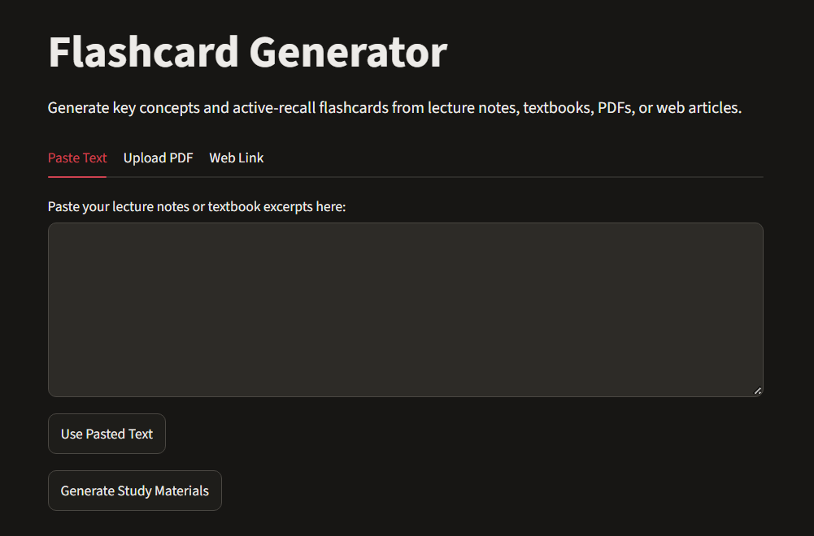

# AI Study Assistant and Flashcard Generator

A web app that turns lecture notes into a summary and flashcards for revision. You give it some study material, and it uses Google's Gemini AI to pull out the key points and make question-and-answer flashcards. It is written in Python with Streamlit.

I made this as a first-year uni student to practise Python and to learn how to use an AI API in a real project.

**[Try the live demo](https://ai-study-assistant-67.streamlit.app/)**

The demo is on free hosting, so it may be asleep when you open it. If you see a "wake up" button, click it and wait a moment.

<!-- TODO: add a screenshot here once you have one:

-->

## What it does

You can give it your notes in three ways:

- **Paste text** straight into the app
- **Upload a PDF**, such as slides or a textbook chapter
- **Enter a web page link**, and the app fetches the article text

It then shows a short summary of the key concepts and a set of flashcards (a question on one side and the answer on the other).

## Run it locally

You need Python 3 (I used 3.14) and a Google Gemini API key.

```
git clone https://github.com/AngaddeepSingh/ai-flashcards-generator.git
cd ai-flashcards-generator
pip install -r requirements.txt
```

<!-- TODO: check that requirements.txt is in the repo and lists everything the app needs. -->

Create a file called `.env` in the project folder and put your key in it:

```
GEMINI_API_KEY=your_key_here
```

Then start the app:

```
streamlit run app.py
```

Don't upload your `.env` file to GitHub. It is meant to stay on your own computer, so the key doesn't end up public.

## Project structure

| File | What it does |
|---|---|
| `app.py` | The Streamlit page: the three input tabs, the buttons, and showing the summary and flashcards |
| `generator.py` | Connects to Gemini, sends the prompt and gets the answer back |
| `schema.py` | Describes what the AI's answer should look like (a summary and a list of flashcards), using Pydantic |
| `utils.py` | Helper functions for reading PDFs and getting the text from web pages |
| `.env` | Holds the API key. Not included in the repo |

## How it works

- The notes are sent to Gemini with a prompt asking for a summary and flashcards. I asked it to reply in JSON that matches the classes in `schema.py`, so the app can read the answer as Python objects instead of trying to pick apart plain text.
- PDFs are read page by page with the `pypdf` library.
- For web pages, the app downloads the page with `requests` and uses BeautifulSoup to remove scripts, menus and footers, leaving the article text.
- The API key is loaded from the `.env` file with `python-dotenv`, so it isn't written in the code.

## How the project developed

1. **The idea.** I wanted a study tool that could take lecture notes and make flashcards for active recall. I picked Python, Streamlit for the interface (so I didn't need to write HTML or JavaScript) and the Gemini API for the AI part.
2. **Structured output.** I used Pydantic to describe the summary and flashcards, so the answer from the AI always comes back in the same format.
3. **More input types.** At first it only took pasted text, but notes are often PDFs or web pages. I added PDF reading and web page fetching, and moved that code into `utils.py` to keep `app.py` tidy.
4. **Bugs I had to fix.**
   - Streamlit re-runs the whole script every time a button is clicked, which wiped my inputs. I fixed it by storing the text with `st.session_state`.
   - The three tabs were overwriting each other's input, so each tab now has its own button and handling code.
   - Very long texts (50,000 to 100,000+ characters, like long Wikipedia pages) made the API slow and sometimes return 503 errors. I added a 20,000 character limit with a warning to the user.

## Known issues and limitations

- Input is limited to 20,000 characters, and the app shows a warning for longer texts
- The flashcards come from an AI, so they can contain mistakes and should be checked against the original notes
- `pypdf` only reads text, so scanned PDFs that are really images probably won't work
- Some web pages may not work, for example ones that block scripts or only load their content with JavaScript
- It needs an internet connection and an API key, and the free API has usage limits
- The live demo can be slow to load because of the free hosting

## Future plans

- Handle longer texts by splitting them into chunks, instead of limiting the length
- Export the flashcards to a file, for example for Anki
- Add automated tests for the helper functions
- Let the user choose how many flashcards to make

<!-- TODO: keep only the plans you actually want to do, and change them if you have your own. -->

## Credits and honesty note

Built with [Streamlit](https://streamlit.io/), the Google Gemini API, Pydantic, pypdf, requests and BeautifulSoup. I wrote the application myself and used AI tools for guidance and some code, which I then adapted and debugged. I'm happy to explain any part of the code.

<!-- TODO: edit this note so it matches what you actually did. -->
